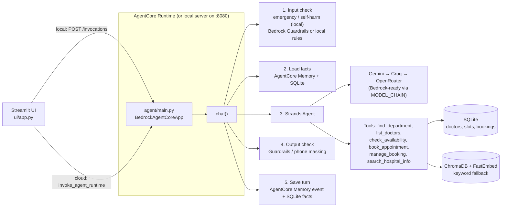

# Hospital Front-Desk Agent

An AI front-desk assistant for a fictional clinic, built with **Strands Agents** and deployed on
**Amazon Bedrock AgentCore Runtime**, with **AgentCore Memory** and **Amazon Bedrock Guardrails**.

**▶ [Demo video](https://drive.google.com/file/d/1yoioEjoMeLA-ZQVEJndpx0BMAl0WvLD7/view)**

- **Books appointments safely:** routes symptoms to a department, lists doctors and free times from
  SQLite, and books, views or cancels appointments. Confirm-before-booking is enforced in code, and
  booking is idempotent.
- **Answers clinic questions with RAG:** ChromaDB + FastEmbed over the clinic's FAQ pages, with a
  relevance cut-off and a keyword fallback. Answers name the page they come from.
- **Stays safe:** never diagnoses or suggests medicines, using Bedrock Guardrails with a local
  fallback. Emergencies get "call 108", and self-harm gets the Tele-MANAS helpline, before any model
  is called.

> Learning project. Sunrise Clinic and all data are fictional. Not medical advice.

Repository: https://github.com/KARINGU-RAVI/hospital-assistant

## Status
- [x] Phase 0 — setup
- [x] Phase 1 — data + tools
- [x] Phase 2 — agent + model fallback
- [x] Phase 3 — RAG
- [x] Phase 4 — Guardrails + Memory
- [x] Phase 5 — AgentCore entrypoint + Streamlit UI
- [x] Phase 6 — deploy to AgentCore Runtime
- [x] Phase 7 — polish

Build guides: `docs/phases/`. Rules for Claude Code: `CLAUDE.md`.

## Architecture


Each chat turn runs **guardrail → memory → model → guardrail → memory**. Emergencies and blocked
medical-advice questions are answered before any model call.

## Tech stack
| Part | What is used | Notes |
|---|---|---|
| Agent | Strands Agents 1.65 | tools are plain Python functions wrapped with `@tool` |
| Models | Gemini `gemini-3.5-flash-lite` → Groq `openai/gpt-oss-120b` → OpenRouter (optional) | free tiers; **Bedrock-ready** via `MODEL_CHAIN=bedrock,...`, but no Bedrock model has run yet |
| Hosting | Amazon Bedrock AgentCore Runtime | code-zip deploy (ARM64) with the AgentCore CLI; public network mode |
| Memory | AgentCore Memory (conversation events + user-preference strategy) | SQLite `patient_facts` as fast path and fallback |
| Safety | Amazon Bedrock Guardrails (`ApplyGuardrail`) | denied topics: diagnosis, medication; phone masking |
| RAG | ChromaDB + FastEmbed (`BAAI/bge-small-en-v1.5`) | cosine distance cut-off 0.40, measured on our pages |
| Data | SQLite | doctors, slots, bookings (partial unique index: one active booking per slot) |
| UI | Streamlit | local or cloud mode |
| Observability | OpenTelemetry traces in CloudWatch (Transaction Search) | via the AgentCore runtime |
| Tests | pytest (about 200 offline tests, plus one opt-in live test) | no AWS access needed |

## Fallbacks (silent to the user, one log line each)
| Part | Normal path | Fallback | Log line |
|---|---|---|---|
| Model | Gemini | Groq, then OpenRouter. Triggers: 429, auth, 404 model-not-found, 5xx, timeouts, connection errors, Bedrock unavailable. The last model gets one retry after 2 s. | `fallback: gemini -> groq (429)` |
| All models down | — | "The assistant is busy, please try again in a minute." | `fallback: groq -> none (...)` |
| RAG | vector search (ChromaDB + FastEmbed) | keyword search over the same FAQ files | `fallback: rag vector -> keyword` |
| Guardrails | Bedrock `ApplyGuardrail` | local regex rules (medical advice, phone masking) | `fallback: guardrails -> local` |
| Memory | AgentCore Memory | SQLite `patient_facts` only | `fallback: memory -> local` |
| Emergencies | always local, before any AWS or model call | — | — |

## Setup (Windows PowerShell, Python 3.12)
```powershell
python -m venv .venv
.venv\Scripts\activate
pip install -r requirements.txt
copy .env.example .env          # then type your own keys into .env (each setting once)
python -m agent.config          # keys show only as set / missing
python data\seed.py             # fake clinic: 4 departments, 6 doctors, 7 days of slots
python data\build_index.py      # FAQ index (downloads the ~67 MB embedding model once)
pytest -q
```

## Run locally
```powershell
python -m agent.cli             # terminal chat as patient P001 / Ravi
# or the full app, in two windows:
python -m agent.main            # window 1: AgentCore SDK server on http://127.0.0.1:8080
streamlit run ui/app.py         # window 2: chat UI
```
Opt-in live test (real model calls): `$env:RUN_LIVE="1"; pytest -q tests\test_live_chat.py; Remove-Item Env:RUN_LIVE`

## AWS (Phases 4–6)
Every AWS step costs money and is run only after the developer confirms (see `CLAUDE.md`).
```powershell
python scripts\aws_setup.py             # guardrail + AgentCore Memory; prints IDs for .env
python scripts\build_runtime.py         # build\runtime + agentcore\agentcore.json (git-ignored)
cd agentcore\cdk; npm install; cd ..\..
agentcore deploy --region ap-south-1    # AgentCore CLI (npm @aws/agentcore), needs uv
```
For cloud mode, set `APP_MODE=cloud` and `AGENT_RUNTIME_ARN` in `.env`, then run `streamlit run ui/app.py`.

## Cost
- **Models:** free tiers. Limits checked in the providers' consoles in November 2026; they change, so recheck.

  | Model | Requests/min | Tokens/min | Per day |
  |---|---|---|---|
  | Gemini `gemini-3.5-flash-lite` (primary) | 15 | 250K | 500 requests |
  | Groq `openai/gpt-oss-120b` (fallback) | 30 | **8K** (the tight one) | 1K requests, 200K tokens |

  One chat turn makes several model calls, so requests are kept small:
  - the model sees at most the last 6 messages or about 3K tokens, cut so that a tool call keeps
    its result, with a text-only summary of turns that are too long;
  - tool results are compact;
  - the system prompt is under 300 words.
- **AWS actually spent: a few US cents** for Phases 4–6: Guardrails, Memory, a few hours of Runtime,
  S3 and CloudWatch. All resources were torn down the same day.
- **Left on purpose:** the CDK bootstrap stack `CDKToolkit`, kept for a possible redeploy. Its S3
  bucket holds about 240 MB of deploy zips, which costs under 1 US cent a month. Its ECR repository
  is empty.

## Teardown
1. `python scripts\aws_teardown.py` deletes the guardrail and the memory (type DELETE).
2. `agentcore remove all --yes`, then `agentcore deploy --yes --region ap-south-1`, deletes the
   runtime stack. The runtime's CloudWatch log group (`/aws/bedrock-agentcore/runtimes/...`, a few KB)
   is left behind; delete it in the CloudWatch console if you want nothing left.
3. **After recording the demo:** the AgentCore CLI turns on CloudWatch Transaction Search with 100%
   span indexing (AgentCore traces need it; the docs say 1% indexing is free). Lower it to 1%:
   ```powershell
   aws xray update-indexing-rule --name "Default" --rule '{\"Probabilistic\": {\"DesiredSamplingPercentage\": 1}}' --region ap-south-1
   ```
4. **Final teardown only:** `CDKToolkit` is not removed by step 2. Its S3 bucket is versioned and
   retained when the stack is deleted, according to the installed bootstrap template (the CDK docs
   give no removal steps):
   ```powershell
   aws cloudformation delete-stack --stack-name CDKToolkit --region ap-south-1
   aws cloudformation wait stack-delete-complete --stack-name CDKToolkit --region ap-south-1
   ```
   Then, in the S3 console, open bucket `cdk-hnb659fds-assets-<account-id>-ap-south-1` and choose
   **Empty** (this removes all versions), then **Delete**.

## Known limitations
- **Cloud sessions don't share bookings.** Each AgentCore Runtime session runs in its own microVM, and
  its disk is wiped when the session ends (after 15 minutes idle, 8 hours at most). The bundled SQLite
  database is copied to `/tmp` at start, so bookings and local patient facts last only for one session
  in the cloud. Locally, everything persists in `data/hospital.db`.
- **Long-term memory needs explicitly stated preferences.** In testing, booking conversations created
  conversation events (12 for one patient) but no long-term preference records. The user-preference
  strategy appears to need preferences the patient states outright ("I prefer Dr. Rao"). In the cloud, a
  new session's "usual doctor" depends on those records; locally it comes from SQLite.
- **Token metrics in CloudWatch appear only for Bedrock models.** This project's Gemini and Groq calls
  show up as traces, without token-usage metrics.
- API keys are passed as plain-text runtime environment variables, which is acceptable for a one-day
  demo with free-tier keys. A longer-lived deploy should use AWS Secrets Manager.

## What I'd add next
- Bedrock models (Nova / Claude) as the primary model once quota is granted (`MODEL_CHAIN=bedrock,gemini,groq`).
- DynamoDB for bookings and patient facts, so they are shared across cloud sessions.
- AgentCore Gateway (tools as managed endpoints) and AgentCore Identity (patient sign-in).
- Bedrock Knowledge Bases as a managed alternative to the local ChromaDB index.

## Project layout
```
agent/    main.py (AgentCore entrypoint), agent.py (prompt, tools, chat flow), models.py (fallback chain),
          guardrails.py, memory.py, config.py, cli.py, tools/{departments,booking,rag}.py
data/     seed.py, build_index.py, faq/*.md   (hospital.db, chroma/, models/ are generated)
scripts/  aws_setup.py, aws_teardown.py, build_runtime.py
agentcore/ agentcore.template.json + CDK app (agentcore.json and aws-targets.json are generated)
ui/app.py, tests/, docs/phases/
```
